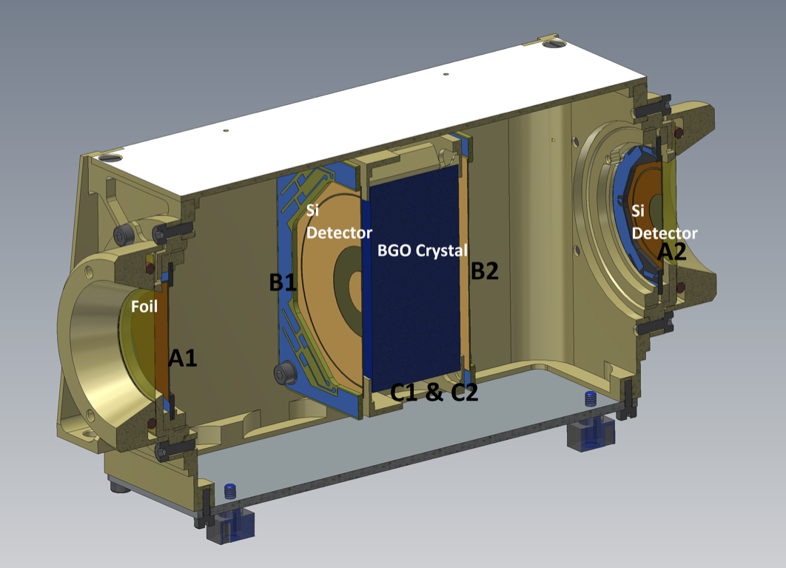

See more details [here](https://espada.uah.es/epd/)

<!--more-->

## Featured Plots

### Option 1: Side-by-Side Layout

  <figure style="margin: 0;">
    
    <figcaption style="text-align: center; margin-top: 0.5rem; font-size: 0.9rem; color: #6c757d;">Plot 1 Caption</figcaption>
  </figure>
  <figure style="margin: 0;">
    <iframe src="featured.pdf" width="100%" height="400px" style="border: none; border-radius: 0.5rem; box-shadow: 0 2px 8px rgba(0,0,0,0.1);">
      
Your browser does not support PDFs. <a href="featured.pdf">Download the PDF</a> instead.

    </iframe>
    <figcaption style="text-align: center; margin-top: 0.5rem; font-size: 0.9rem; color: #6c757d;">PDF Document</figcaption>
  </figure>

### Option 2: Simple Image Grid (for multiple PNG/JPG files)

<!-- Uncomment and add more images as needed -->
<!--

  
  
  

-->

### Option 3: Vertical Stack

<!--

*Caption for Plot 1*

*Caption for Plot 2*

*Caption for Plot 3*
-->

### Option 4: Using Hugo Figure Shortcode

<!--



-->
<!--
## Project Pages

- [Overview](overview/) - Project overview and details
- [Results](results/) - Experimental results
- [Publications](publications/) - Related publications
-->